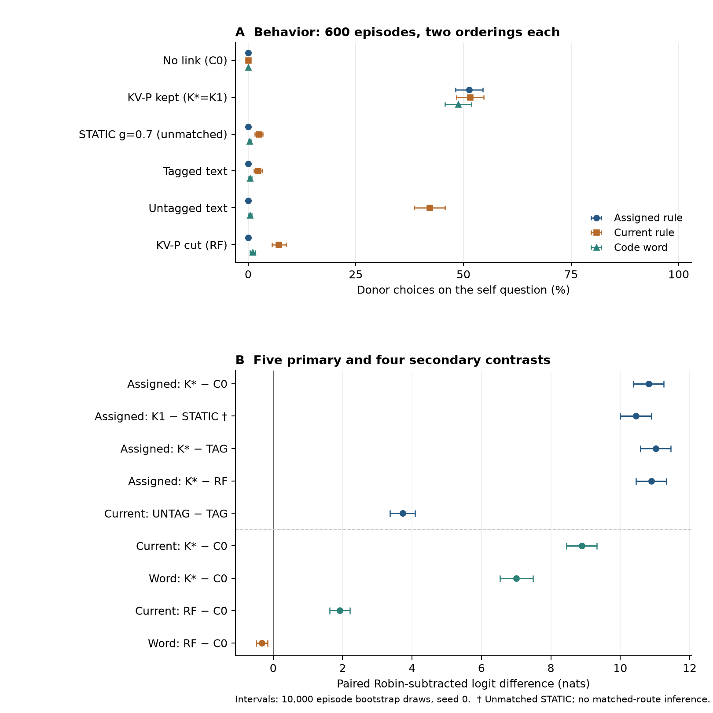

# V4 formal results: Llama 3.1 8B Instruct

## Main finding and scope

The internal-memory link increased attribution of the donor's assigned rule to the receiver relative to no link (K*−C0 M = 10.8229 nats, 95% episode-bootstrap CI [10.3746, 11.2529]). The receiver selected the donor's rule as its original assignment in 51.333% of orderings, versus 0.000% under C0. These are distinct behavioral and logit results.

The tagged-text and link-cut controls separate several effects, but this run does **not** establish the matched-access route claim: STATIC was available and estimable but unmatched, and the independent route-validity check failed. The code-word effect after cutting the link is also a boundary: its prespecified Robin-subtracted logit effect is negative, despite a small positive donor-choice rate. Each hypothesis is reported separately; this is not an all-or-nothing replication verdict.

## Data, frozen design, and reproduction

- Original run: `20261009-005433_v4_llama31_confirm_v4_confirm`; all 600 paired episodes, seven unique arms, 84,000/84,000 readouts.
- K*=K1 at KV-P w=1; STATIC layer 21, raw direction, gain 0.7. Strength and STATIC gain were selected using independent access/CAP/format data; all settings were frozen before formal attribution analysis.
- Two counterbalanced label orderings are averaged within each episode before inference. No episode was excluded, no missing value was imputed, and no parameter was reselected after formal outcomes.
- The interrupted run resumed in the same directory. The two immutable shards contain 9,960 and 74,040 successful readouts; the technical closeout verified preservation of original data and shared FULL/RF snapshots.
- Raw recomputation agrees with stored `v4_contrasts.json` in structure and numerical values within 1e-12 relative/absolute tolerance (p-values use relative tolerance only). Differences are floating-point roundoff only, with maximum absolute difference 2.71e-20. Raw inputs were hash-checked before/after analysis.

Reproduce from the mounted SD card (CPU only; no torch or model):

```bash
.venv/bin/python scripts/report_v4_formal.py
```

Use `--check-only` to validate/recompute without writing derived files. `summary.json` records raw-input and source hashes, exact effects, all descriptive counts, and the frozen pilot evidence. [Protocol](../../protocol/PROTOCOL_V4.md) sections 4–5 specify the analysis.

## Metrics and inferential units

For each ordering, L_self = z(partner) − z(own) on the self question, and L_Robin = z(partner) − z(Robin) on its Robin counterpart. M = L_self − L_Robin for START; M_NOW and M_WORD apply the same subtraction to NOW and WORD. Logit differences equal natural-log probability ratios (nats); they are neither percentages nor normalized four-choice probabilities. Positive arm differences indicate a relative preference shift after Robin subtraction, not by themselves a behavioral takeover rate.

The primary family contains five two-sided paired t-tests; the secondary family contains four, with separate Holm familywise correction at 0.05. Every contrast has N=600 paired episodes. CIs use 10,000 episode-bootstrap draws, seed 0; they are pointwise 95% percentile intervals, not simultaneous Holm-adjusted intervals. Expected positive signs did not change the two-sided tests.

## Primary family (five tests)

| Contrast | Metric | Paired N | Mean (nats) | 95% CI | t (df=599) | p, two-sided | p, Holm |
| --- | --- | --- | --- | --- | --- | --- | --- |
| K* − C0 | M | 600 | 10.8229 | [10.3746, 11.2529] | 48.009 | 1.75e-207 | 5.24e-207 |
| K1 − STATIC † | M | 600 | 10.4514 | [9.9936, 10.8908] | 45.554 | 9.17e-197 | 1.83e-196 |
| K* − TAG | M | 600 | 11.0235 | [10.5730, 11.4575] | 48.313 | 8.59e-209 | 3.44e-208 |
| K* − RF | M | 600 | 10.8931 | [10.4550, 11.3236] | 48.781 | 8.6e-211 | 4.3e-210 |
| UNTAG − TAG | M_NOW | 600 | 3.7253 | [3.3670, 4.0816] | 20.106 | 4.21e-69 | 4.21e-69 |

## Secondary family (four tests)

| Contrast | Metric | Paired N | Mean (nats) | 95% CI | t (df=599) | p, two-sided | p, Holm |
| --- | --- | --- | --- | --- | --- | --- | --- |
| K* − C0 | M_NOW | 600 | 8.8887 | [8.4545, 9.3199] | 40.397 | 3.53e-173 | 1.41e-172 |
| K* − C0 | M_WORD | 600 | 7.0058 | [6.5344, 7.4841] | 29.156 | 5.25e-117 | 1.58e-116 |
| RF − C0 | M_NOW | 600 | 1.9168 | [1.6309, 2.2136] | 12.857 | 1.4e-33 | 2.8e-33 |
| RF − C0 | M_WORD | 600 | -0.3298 | [-0.4948, -0.1622] | -3.901 | 0.000106 | 0.000106 |

† K1−STATIC remains an available prespecified statistical test in the five-test family. Its positive difference cannot be interpreted as an effect at matched access. No comparison was removed from multiplicity bookkeeping. The negative RF−C0 M_WORD contrast is significant in the opposite direction to a positive residual code-word effect.

## Actual claiming choices (descriptive)

Each self-question cell is the donor/partner argmax count divided by **1,200 choices = 600 episodes × two orderings**. The inferential N remains 600. Values are scored separately for each ordering; they are not argmaxes of probabilities pooled across orderings. Zero means no such choice was observed in this sample, not a universal absence of the behavior.

| Arm | Assigned rule (START) | Current rule (NOW) | Code word (WORD) |
| --- | --- | --- | --- |
| C0 | 0/1200 (0.000%) | 0/1200 (0.000%) | 0/1200 (0.000%) |
| K* | 616/1200 (51.333%) | 618/1200 (51.500%) | 585/1200 (48.750%) |
| STATIC | 0/1200 (0.000%) | 29/1200 (2.417%) | 4/1200 (0.333%) |
| TAG | 0/1200 (0.000%) | 27/1200 (2.250%) | 5/1200 (0.417%) |
| UNTAG | 0/1200 (0.000%) | 506/1200 (42.167%) | 5/1200 (0.417%) |
| RF | 0/1200 (0.000%) | 85/1200 (7.083%) | 12/1200 (1.000%) |
| CF | 610/1200 (50.833%) | 597/1200 (49.750%) | 578/1200 (48.167%) |

CF choices refer to the replacement donor's content. All arm/question choice categories, including own, Robin and unused/distractor choices, are retained in `summary.json`. Behavioral intervals in the plot resample the 600 episode means; they do not use a binomial N=1,200.

**Tagged versus untagged text.** Removing the source header increased current-rule adoption from 2.250% to 42.167%. Both text conditions nevertheless had 0.000% assigned-rule donor choices. Thus the current-rule effect is not evidence that the receiver reassigned its original rule. This additional checkpoint supports the header effect on current-rule adoption; it does not reproduce an untagged-text behavioral increase in assigned-rule claiming in this sample.

**Content access versus assigned-rule claiming.** Tagged text gave 86.583% correct donor-rule access, exceeding K*'s 43.417%, while assigned-rule claiming was 0.000% versus 51.333%. This is a descriptive dissociation between access and self-attribution; it is not a strength-matched isolation of route.

## Robin-subtracted components (all arms; descriptive)

Absolute means below are first averaged across the two orderings and then across 600 episodes. The last three columns show arm−C0 changes; ΔM = Δself − ΔRobin. All entries are nats.

| Arm | Metric | Self | Robin | M | Δself | ΔRobin | ΔM |
| --- | --- | --- | --- | --- | --- | --- | --- |
| C0 | M | -12.0251 | -11.8418 | -0.1833 | 0.0000 | 0.0000 | 0.0000 |
| C0 | M_NOW | -9.0610 | -10.5717 | 1.5106 | 0.0000 | 0.0000 | 0.0000 |
| C0 | M_WORD | -10.7897 | -10.3911 | -0.3986 | 0.0000 | 0.0000 | 0.0000 |
| K* | M | 0.0465 | -10.5930 | 10.6396 | 12.0717 | 1.2488 | 10.8229 |
| K* | M_NOW | 0.2093 | -10.1900 | 10.3993 | 9.2703 | 0.3817 | 8.8887 |
| K* | M_WORD | -0.1142 | -6.7215 | 6.6072 | 10.6755 | 3.6696 | 7.0058 |
| STATIC | M | -9.6568 | -9.8450 | 0.1882 | 2.3683 | 1.9968 | 0.3715 |
| STATIC | M_NOW | -6.9244 | -9.0479 | 2.1235 | 2.1366 | 1.5237 | 0.6129 |
| STATIC | M_WORD | -8.8430 | -8.6501 | -0.1928 | 1.9467 | 1.7409 | 0.2058 |
| TAG | M | -12.0076 | -11.6237 | -0.3839 | 0.0175 | 0.2181 | -0.2006 |
| TAG | M_NOW | -4.5906 | -10.2926 | 5.7020 | 4.4704 | 0.2791 | 4.1913 |
| TAG | M_WORD | -10.1291 | -10.2779 | 0.1488 | 0.6606 | 0.1131 | 0.5474 |
| UNTAG | M | -11.5667 | -11.2327 | -0.3340 | 0.4584 | 0.6091 | -0.1507 |
| UNTAG | M_NOW | -0.6021 | -10.0294 | 9.4273 | 8.4589 | 0.5422 | 7.9167 |
| UNTAG | M_WORD | -9.6380 | -9.6046 | -0.0335 | 1.1517 | 0.7865 | 0.3652 |
| RF | M | -12.0612 | -11.8077 | -0.2535 | -0.0361 | 0.0341 | -0.0702 |
| RF | M_NOW | -7.1955 | -10.6229 | 3.4275 | 1.8656 | -0.0513 | 1.9168 |
| RF | M_WORD | -10.4262 | -9.6978 | -0.7284 | 0.3635 | 0.6932 | -0.3298 |
| CF | M | -0.0649 | -10.5784 | 10.5135 | 11.9602 | 1.2634 | 10.6968 |
| CF | M_NOW | -0.0498 | -10.1621 | 10.1123 | 9.0112 | 0.4095 | 8.6016 |
| CF | M_WORD | -0.3579 | -6.6831 | 6.3253 | 10.4318 | 3.7080 | 6.7239 |

**Why RF code-word choices and M_WORD differ.** RF selected the donor word in 12/1200 orderings (1.000%), versus 0/1200 under C0. Yet the raw self-question logit component changed by 0.3635, while the Robin-question component changed by 0.6932; subtraction gives RF−C0 M_WORD = -0.3298 (95% CI [-0.4948, -0.1622], Holm p=0.000106). Argmax events and the episode-mean logit contrast measure different features. This result cannot be reported as a positive Robin-subtracted residual code-word effect, or as an absence of all donor-word influence. By contrast, the RF current-rule secondary contrast is positive; cutting the link changes assigned, current-rule and code-word readouts differently.

## Access, capability, and format (all arms)

ACC_RULE is z(partner)−z(unused); ACC_WORD is z(partner)−z(distractor). Their gains below are paired arm−C0 mean differences. CAP is mean correctness over two items and both orderings within episode (2,400 descriptive choices per arm). Label mass is probability on the four valid answer tokens, not probability renormalized over them. The engineering screen uses the four access/CAP questions; the all-question label mass is also shown.

| Arm | Rule gain | Word gain | Rule access | Word access | CAP | CAP drop (pp) | Mass: access/CAP | Mass: all | Formal screen |
| --- | --- | --- | --- | --- | --- | --- | --- | --- | --- |
| C0 | 0.0000 | 0.0000 | 14.417% | 4.417% | 94.750% | 0.0000 | 99.871% | 99.946% | True |
| K* | 2.4896 | 2.5565 | 43.417% | 42.583% | 89.750% | 5.0000 | 99.866% | 99.944% | True |
| STATIC | 0.4206 | -0.0374 | 17.083% | 4.167% | 94.917% | -0.1667 | 98.511% | 99.230% | True |
| TAG | 5.9183 | 3.2383 | 86.583% | 56.750% | 94.458% | 0.2917 | 99.894% | 99.929% | True |
| UNTAG | 0.6563 | 0.6772 | 27.667% | 18.417% | 94.208% | 0.5417 | 99.873% | 99.929% | True |
| RF | -0.1160 | 0.0402 | 10.833% | 4.083% | 94.708% | 0.0417 | 99.873% | 99.947% | True |
| CF | 2.5771 | 2.5352 | 44.667% | 43.583% | 89.667% | 5.0833 | 99.865% | 99.943% | False |

K*'s formal CAP drop is exactly 5.000000 percentage points, at the prespecified ≤5-point boundary. CF's drop is 5.083333 points, 0.083333 points above it (two extra incorrect CAP choices out of 2,400 relative to the 5-point boundary). The formal CF engineering screen therefore fails slightly. This is a reported quality limitation, not a reason to discard episodes, change parameters, or rerun selection. Formal rechecks do not retroactively alter the passing independent core gate.

## Content counterfactual and matching limits

For each episode, the physical original donor candidate r0 and replacement candidate r1 stay fixed while computing Q=z(r1)−z(r0). C_content = Q_CF−Q_K*. Recipient question hashes must match between the paired arms. This tests sensitivity to which content the donor carries rather than a change in the meaning label assigned to an option.

| Content | Paired N | Missing | Mean (nats) | One-sided 95% lower bound | Lower bound >0 |
| --- | --- | --- | --- | --- | --- |
| rule | 600 | 0 | 5.0326 | 4.7415 | True |
| word | 600 | 0 | 5.0311 | 4.8027 | True |

These are the prespecified formal content checks, using 10,000 episode-bootstrap draws and seed 0. They are not extra members of either two-sided contrast family. Because K*=K1, no additional distinct CF-w1 arm was needed. The small formal CF CAP exceedance above limits the manipulation-quality interpretation.

The independent 80-episode **core validity gate passed**, but matching and independent route validation were false. STATIC was already unmatched in its 40-episode matching pilot. In the formal sample, K1's rule-access gain is 2.4896 nats and STATIC's is 0.4206; the absolute gap is 2.0690, or 83.106% of the K1 gain, exceeding the 25% matching tolerance. The K1−STATIC effect remains a valid observed contrast between the selected interventions, but does not identify a route effect at equal access.

## Interpretation and limitations

- Supported here: increased assigned-rule claiming with the internal-memory link; a positive kept-versus-cut assigned-rule contrast; and a source-header effect on current-rule adoption.
- Scope limits: unequal-access STATIC and text comparisons do not isolate route at matched strength. The RF code-word secondary metric shifts negatively, whereas RF current-rule adoption remains above C0. Untagged text does not produce assigned-rule donor choices in these data.
- Capability/format checks are manipulation-quality diagnostics, not a guarantee of otherwise unchanged behavior. K* lies on the formal CAP boundary and CF narrowly exceeds it.
- These effects describe one additional pinned checkpoint, one task/material set, and forced-choice readouts. They do not establish consciousness, subjective experience, a general law of LLMs, or a complete mechanism. No new self-report, third-person, or two-way/live-loop replication was performed.
- Qwen and Llama episodes are not pooled. Raw logit magnitudes across models are not a calibrated common scale; cross-model claims should concern specific patterns and boundaries rather than equating effect magnitudes.

## Figure



A: donor choices on the three self questions for the six non-CF conditions; descriptive pointwise 95% episode-bootstrap intervals (600 episodes, two orderings each). A zero-width interval at zero is the empirical bootstrap boundary, not proof of a population rate of zero. CF is included in all tables and content checks. B: all nine prespecified logit contrasts with pointwise 95% episode-bootstrap intervals; Holm p-values are reported separately above. † denotes the unmatched STATIC comparison. [Vector PDF](formal_overview.pdf).
